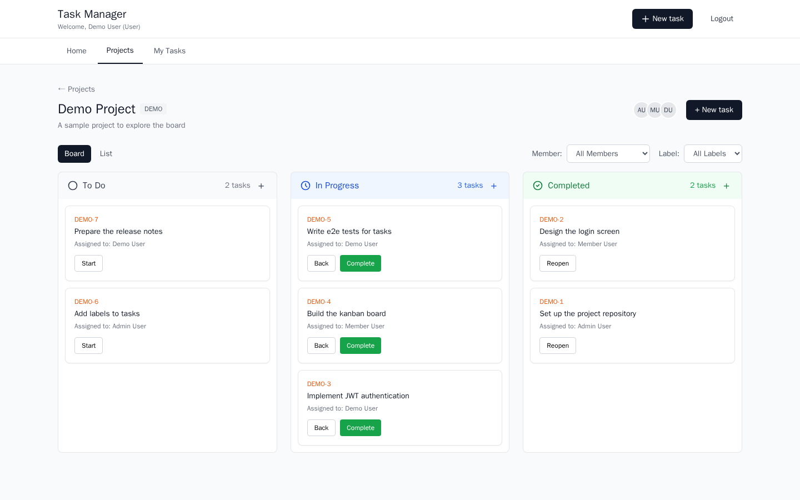
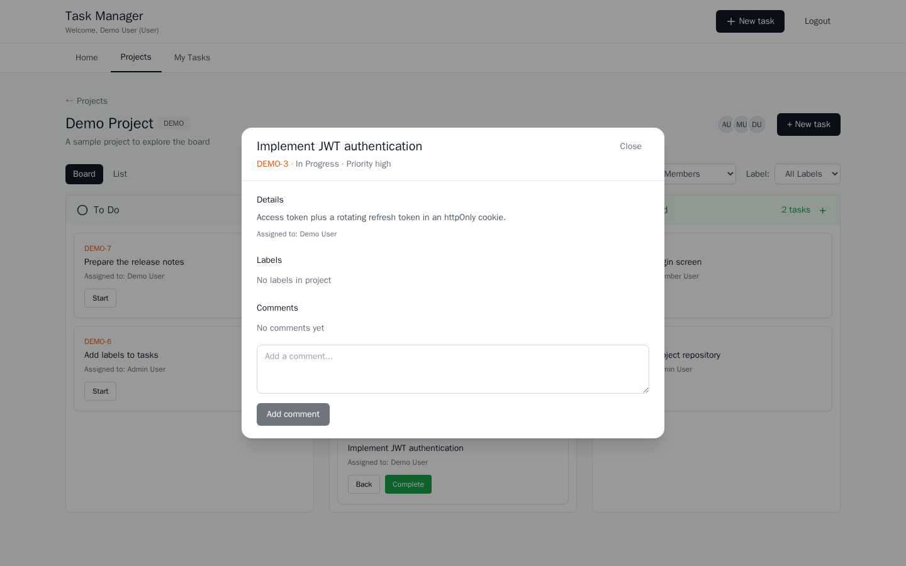
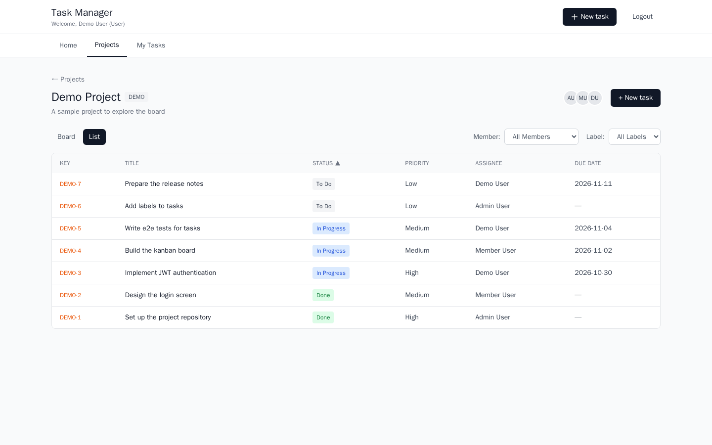
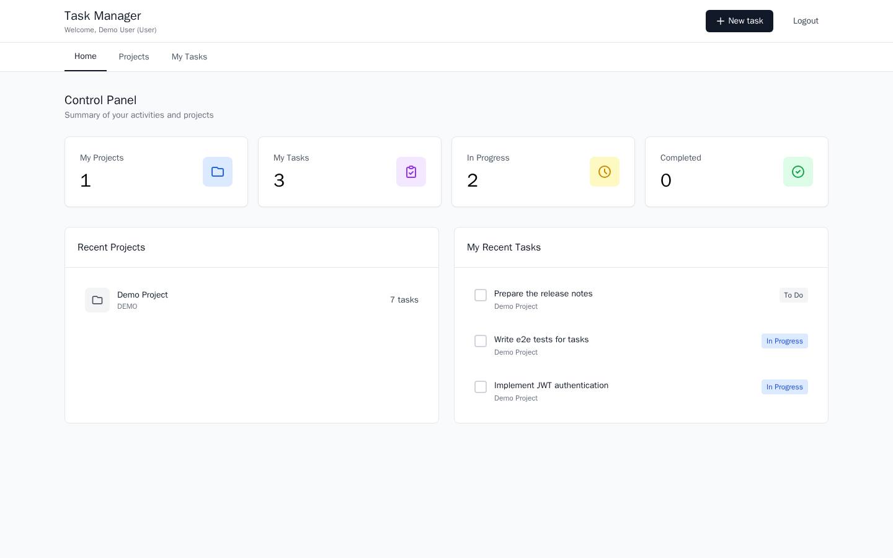
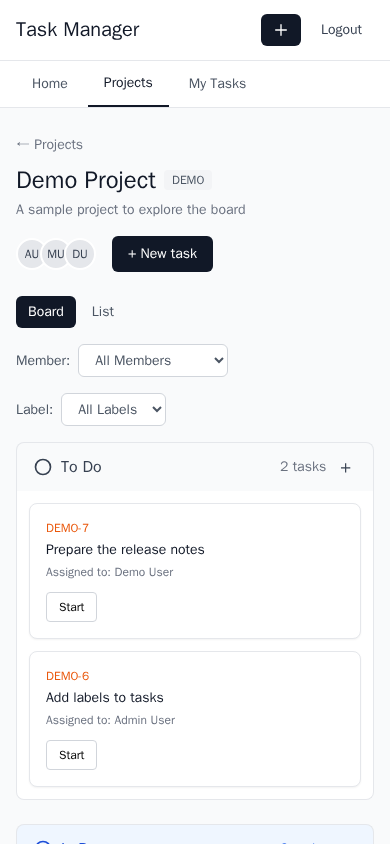
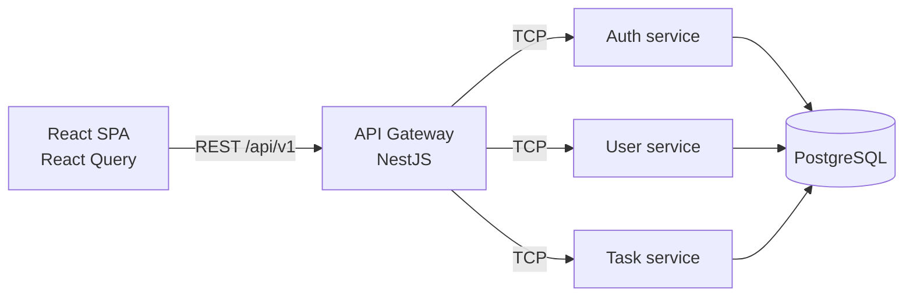

# Task Manager

A project and task management app in the spirit of Jira: projects with members and roles, a kanban board with drag and drop, task keys (`WEB-12`), history, comments and labels. Built as an Nx monorepo with a NestJS API gateway, three NestJS microservices over TCP, PostgreSQL and a React 19 frontend.

[](https://github.com/whoyoshome/task-management/actions/workflows/ci.yml)
[](https://www.typescriptlang.org/)
[](https://nestjs.com/)
[](https://react.dev/)
[](https://nodejs.org/)

## Live demo

**https://task-management-whoyoshome.vercel.app**

Log in with **`demo@example.com` / `Password123!`** (or click *Use the demo account*). It is a regular project member: create, assign and move tasks; project administration needs an admin.

The backend runs on a free instance that sleeps when idle: the first visit can take up to a minute, and the login page says so while it wakes up.

| Board | Task detail |
|---|---|
|  |  |
| **List view** | **Dashboard** |
|  |  |

<p align="center"></p>

## Features

- **Projects** with members and roles (admin, member, viewer) enforced per project by the API.
- **Kanban board** with drag and drop (keyboard accessible), soft WIP limits, and a sortable **list view**; filters by member and label kept in the URL.
- **Task keys** per project (`DEMO-7`), numbered safely under concurrent creation.
- **Task history** (who changed what), comments, labels, priorities and due dates.
- **Create tasks in context** (from a project or a column, assigned to any member) or from anywhere with a project picker.
- **My Tasks**: tasks assigned to you or created by you, across projects.
- Loading skeletons, empty states with actions, and a responsive layout down to 375 px.

## Architecture



- **API Gateway** (`apps/api-gateway`): the only public entry point. JWT authentication, global and per-project authorization guards, validation, rate limiting, Swagger.
- **Auth service** (`apps/auth-microservice`): issues and rotates tokens; schema `auths`.
- **User service** (`apps/user-microservice`): users and credentials; schema `users`.
- **Task service** (`apps/task-microservice`): projects, members, boards, tasks, history, comments, labels, sprints; schema `tasks`.
- **Client** (`apps/client-app`): React 19, Vite, TanStack Query, Tailwind, dnd-kit.
- **Shared libraries**: DTOs and enums shared by gateway and services (`libs/shared/contracts`), TCP clients, OpenAPI-generated types for the frontend (`libs/shared/api-types`), database and RPC utilities (`libs/utils`).

Each service owns its schema and its TypeORM migrations, which run on startup. More in [docs/ARCHITECTURE.md](docs/ARCHITECTURE.md).

## Engineering highlights

- **Sessions**: short-lived access token; the refresh token lives in an `httpOnly`, `Secure`, `SameSite=Strict` cookie scoped to `/api/v1/auth`, rotates on every use, and is stored only as a hash. Reusing a rotated token revokes all of the user's sessions, with a short grace period for tabs refreshing at once.
- **Authorization**: a project-scope guard resolves the project of every request (from the body, the query or the task id) and denies by default; assignees must be project members.
- **Data integrity**: per-project task numbers come from a locked transaction, so parallel creations never collide (covered by an e2e test); marking a refresh token as used is a single conditional update.
- **Typed end to end**: the frontend uses TypeScript types generated from the gateway's OpenAPI spec.
- **Quality gates**: CI runs lint, unit tests and builds for affected projects, `npm audit` on production dependencies, and an e2e suite against the real services built from their Docker images, with the schema built from migrations.
- **Containers**: multi-stage, non-root images; the TCP services are never exposed outside the Docker network.
- **Deployment**: the live demo runs the whole backend in one free container behind a Vercel proxy, so the cookie stays first-party; the login rate limit keys on a header the host's proxy sets, after testing that the forwarded-for header could be forged there ([docs/DEPLOYMENT.md](docs/DEPLOYMENT.md)).

Trade-offs and talking points: [docs/INTERVIEW-NOTES.md](docs/INTERVIEW-NOTES.md).

## Tech stack

| Area | Tools |
|---|---|
| Backend | NestJS 11, TCP microservices, TypeORM, PostgreSQL, Passport JWT, class-validator, Joi, Winston, Helmet, Throttler |
| Frontend | React 19, Vite 6, TanStack Query 5, React Router 7, Tailwind CSS, dnd-kit, Framer Motion |
| Testing | Jest, Supertest (e2e), Vitest, Testing Library |
| Tooling | Nx 21, TypeScript 5.7, ESLint, openapi-typescript, Docker, GitHub Actions |
| Hosting (demo) | Render (backend), Neon (Postgres), Vercel (frontend) |

## Quick start

Requirements: Docker Desktop. Node.js 24 is only needed to run the tools outside Docker (see `.nvmrc`).

```bash
git clone https://github.com/whoyoshome/task-management.git
cd task-management
cp .env.example .env
npm run docker:up
```

| Service | URL |
|---|---|
| Frontend | http://localhost:5173 |
| API / Swagger | http://localhost:3000/api/docs |
| Health check | http://localhost:3000/api/v1/health |
| pgAdmin | http://localhost:5050 (`admin@admin.com` / `admin`) |
| PostgreSQL | `localhost:5433` (`admin` / `654321`) |

Demo data is seeded automatically (or `npm run seed:all`): a project with a board and sample tasks, and these accounts:

| Role | Email | Password |
|---|---|---|
| Admin | `admin@example.com` | `Password123!` |
| Member | `member@example.com` | `Password123!` |
| Demo (member, no admin rights) | `demo@example.com` | `Password123!` |

## Testing

```bash
npm test             # unit tests, all projects
npm run test:e2e     # API e2e against running services (see the CI workflow)
npx nx e2e client-app-e2e   # browser tests (Playwright) against npm run docker:up
npm run lint
```

The Playwright suite logs in as the demo user, creates a task from a board column and drags it to another one (checking it persists after a reload), renews the session with the refresh cookie, and logs out. CI runs it against the client and gateway images.

## Project structure

```
apps/
  api-gateway/          NestJS gateway (HTTP)
  auth-microservice/    tokens
  user-microservice/    users
  task-microservice/    projects, boards, tasks
  client-app/           React frontend
libs/
  shared/contracts/     DTOs and enums
  shared/clients/       TCP clients
  shared/api-types/     OpenAPI-generated types
  utils/                database, RPC and validation utilities
docker/                 service, demo and seed images
docs/                   architecture, deployment, interview notes
```

## API documentation

Swagger UI at `/api/docs` and the spec at `/api/docs-json`. After changing the API, regenerate the frontend types with the gateway running:

```bash
npm run openapi:types
```

## Migrations

Each microservice owns its schema through TypeORM migrations, which run automatically on startup. `synchronize` is off unless `DB_SYNCHRONIZE=true` (the dev compose override enables it by default for existing local volumes; CI disables it so migrations are tested).

After changing an entity, generate a migration against an up-to-date database and register it in that service's `migrations/index.ts` (imported explicitly so webpack bundles them). The generator writes the schema name literally (`"tasks"."task"`): replace it with `${schema}`, where `const schema = schemaOf(queryRunner)` comes from `@libs/database`, so migrations follow `<SERVICE>_DB_SCHEMA`.

The migration scripts and `npm run seed:all` read the `<SERVICE>_DB_*` variables from the environment or `.env`, with no defaults. From the host, point them at the published port, e.g. `TASK_DB_HOST=localhost TASK_DB_PORT=5433 npm run taskms:migration:run`.

```bash
npm run taskms:migration:generate -- apps/task-microservice/src/app/migrations/AddDueTime
npm run taskms:migration:run
npm run taskms:migration:revert
```

Same scripts exist for `userms` and `authms`.

## Configuration

All settings are environment variables, documented in [.env.example](.env.example). Production and the free demo are covered in [docs/DEPLOYMENT.md](docs/DEPLOYMENT.md).

## License

MIT, see [LICENSE](LICENSE).
