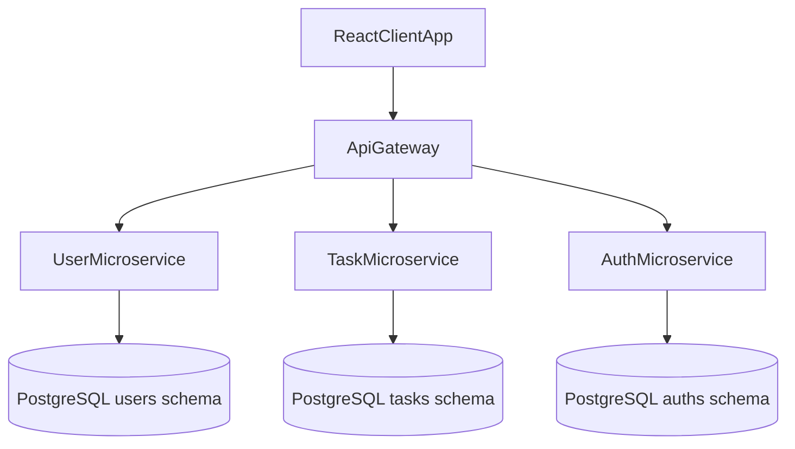

# Architecture

## Overview

Task Management is a full-stack monorepo built with Nx. It exposes a REST API through an API Gateway and splits domain logic across three NestJS microservices that communicate over TCP. A React frontend consumes the API using types generated from the OpenAPI specification.

## Request flow (authenticated)

1. The client sends `Authorization: Bearer <token>` when logged in.
2. The API Gateway validates the JWT and route-level guards (global role, project role, task modify).
3. The gateway calls the appropriate microservice through a TCP client with a shared command contract in `libs/shared/contracts`.
4. The microservice executes domain logic against its PostgreSQL schema and returns the result.

## Why microservices here

This project uses service boundaries to demonstrate:

- Independent deployable units per domain (users, tasks, auth)
- Shared DTO contracts between gateway and services
- Schema-per-service on a single PostgreSQL instance

For an MVP or early-stage product, a modular monolith would be simpler to operate. Microservices were chosen here as a learning and portfolio exercise in distributed boundaries, not because the current scale requires them.

## Security decisions

| Concern | Approach |
|---------|----------|
| Transport auth | JWT access token + refresh token |
| Internal network | TCP microservices are not published outside the Docker network |
| Authorization | Guards for global roles and per-project roles |
| Password storage | bcrypt hashes in the user microservice |
| Token storage (client) | Short-lived access token in localStorage (shared by tabs). Refresh token in an `httpOnly`, `Secure`, `SameSite=Strict` cookie scoped to `/api/v1/auth`, rotated on each refresh; the axios interceptor renews the access token with it |
| Production DB | `synchronize: false`; migrations per service |

## Shared libraries

- `libs/shared/contracts` — DTOs, enums, validation decorators
- `libs/shared/clients` — TCP clients for gateway → microservices
- `libs/shared/api-types` — OpenAPI-generated TypeScript types for the frontend
- `libs/utils` — Cross-cutting validators (remote user/project checks)

## Key domains in the task service

- Projects and members
- Tasks, boards, and columns
- Comments and labels
- Sprints, dependencies, and task history (API-ready; partial UI coverage)

## What I would simplify in an MVP

1. Single NestJS app with modules instead of TCP microservices
2. One database schema with clear module boundaries
3. Deploy as one Docker image + PostgreSQL
4. Keep OpenAPI + React Query + JWT — those add value without operational cost
